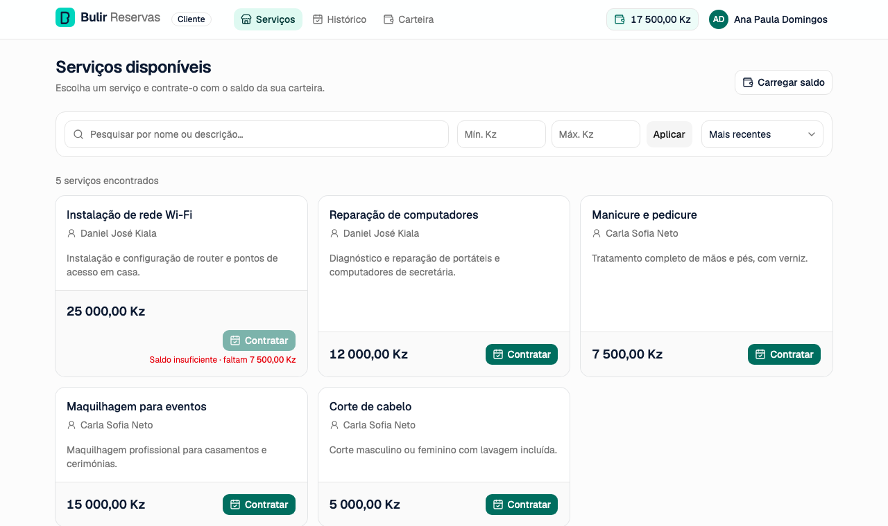
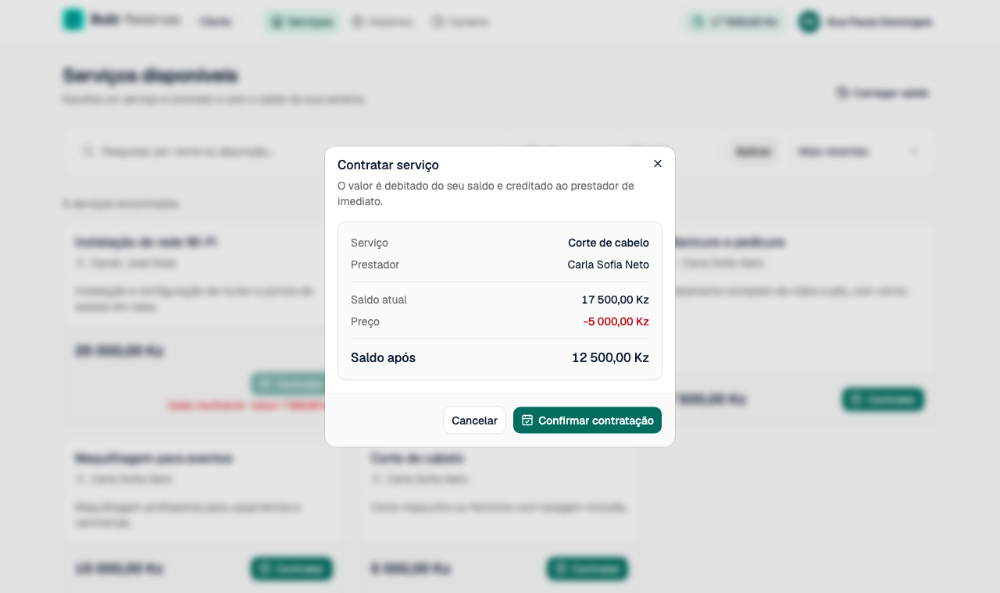
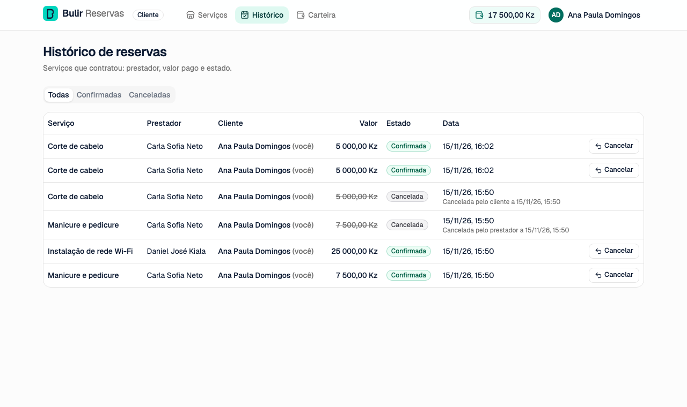
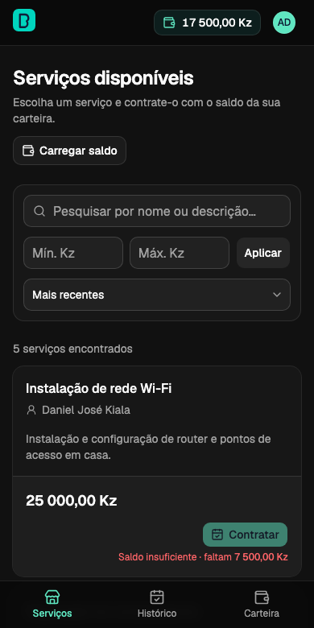

# Bulir Reservas — Web

Aplicação web (React + TypeScript) da plataforma de contratação de serviços da Bulir. Consome a API do
Desafio 1 ([`bulir-reservas-api`](https://github.com/InacioRodrigues/bulir-reservas-api)): clientes contratam
serviços de prestadores e pagam com o saldo da carteira, em Kwanzas.

- **Produção:** _a preencher após o deploy na Vercel_
- **API:** https://bulir-reservas-api-15sk.onrender.com · documentação Scalar em [https://bulir-reservas-api-15sk.onrender.com/reference](https://bulir-reservas-api-15sk.onrender.com/reference)



| Contratar (saldo atual → saldo após)         | Histórico                                    | Mobile (tema escuro)                          |
| -------------------------------------------- | -------------------------------------------- | --------------------------------------------- |
|  |  |  |

## Funcionalidades

| Requisito do enunciado                                                             | Onde                                                                       |
| ---------------------------------------------------------------------------------- | -------------------------------------------------------------------------- |
| Login com **e-mail ou NIF** + senha, JWT guardado em estado global persistido      | `/login` — um só campo "E-mail ou NIF" (a API decide pelo `@`)             |
| Registo como cliente ou prestador                                                  | `/registar`                                                                |
| Prestador: **criar, listar, editar e excluir** serviços (título, descrição, preço) | `/meus-servicos`                                                           |
| Ecrã onde **só clientes** veem todos os serviços                                   | `/servicos` (pesquisa, preço mín./máx., ordenação, paginação)              |
| Contratar com **verificação de saldo antes**                                       | Botão desativado com "faltam X Kz" + diálogo saldo atual → saldo após      |
| **Saldo do cliente e do prestador atualizado** após contratar                      | Saldo relido da API (`GET /auth/me`) após cada operação e a cada 30 s      |
| **Histórico** com serviço, prestador, cliente e valor                              | `/reservas` (filtro por estado, cancelamento com reembolso)                |
| Validação de formulários                                                           | zod + React Hook Form com as mesmas regras do contrato                     |
| Só prestadores criam/editam/excluem                                                | Rotas e botões por papel (UX) + API (autorização real)                     |
| Operações de saldo atómicas                                                        | Garantidas pela API (transação única); o front nunca calcula o saldo final |

Extras: carteira com extrato de movimentos (`/carteira`) e carregamento de saldo, tema claro/escuro, layout
mobile com navegação inferior, contas de demonstração a um clique, aviso de sessão expirada e de falta de rede,
pesquisa e filtros no URL (partilháveis), sessões sincronizadas entre separadores.

## Stack e porquê

| Escolha                                            | Porquê                                                                                                                                                      |
| -------------------------------------------------- | ----------------------------------------------------------------------------------------------------------------------------------------------------------- |
| **Vite + React 19 + TypeScript (strict)**          | É uma SPA autenticada, sem SEO nem SSR: Vite é mais simples e rápido que Next.js. Next faria sentido com páginas públicas indexáveis ou BFF.                |
| **TanStack Query**                                 | Estado do **servidor** (serviços, reservas, saldo): cache, estados de loading/erro, `keepPreviousData` na paginação, invalidação após mutações.             |
| **Zustand** (`persist`)                            | Estado do **cliente**: tokens + snapshot do utilizador e preferência de tema. Pequeno, com pouco código repetitivo, acessível fora de React (interceptors). |
| **Axios** + interceptors                           | Bearer automático, refresh do token em 401, erros normalizados num único `ApiError`.                                                                        |
| **React Hook Form + zod**                          | Formulários performantes e schemas que espelham as regras do contrato (e normalizam NIF, e-mail e dinheiro).                                                |
| **React Router** (data router, lazy)               | Guards por papel, code splitting por página, filtros/paginação no URL.                                                                                      |
| **Tailwind CSS v4 + shadcn/ui (Radix)**            | Componentes acessíveis (diálogos, menus, foco) que ficam no repositório e se adaptam ao design.                                                             |
| **sonner**, **lucide-react**                       | Toasts e ícones.                                                                                                                                            |
| **Vitest + Testing Library + MSW**, **Playwright** | Testes de unidade/componentes com a rede simulada; E2E contra a API real.                                                                                   |
| **oxlint + Prettier**, husky + commitlint          | Lint rápido com regras de React/hooks/a11y; Conventional Commits.                                                                                           |

## Arquitetura

```
src/
  app/                 providers, query client, router (lazy + guards), layouts, 404, error boundary
  features/
    auth/              api, hooks (useLogin, useMe, useLogout), guards, Login/Register
    services/          api, hooks, filtros do catálogo, ServiceCard, ServiceForm, MyServicesPage, CatalogPage
    bookings/          api, hooks, BookServiceDialog, BookingList, CancelBookingDialog, BookingsPage
    wallet/            api, hooks, TopUpDialog, BalanceBadge, TransactionList, WalletPage
  shared/
    contract/          tipos e schemas zod do contrato da API (sem React → reutilizáveis no mobile)
    api/               http.ts (axios + refresh), errors.ts (ApiError + mensagens pt), query-keys.ts
    lib/               money.ts (BigInt), date.ts, utils
    session/, theme/   stores Zustand
    components/, ui/   componentes partilhados e shadcn/ui
```

### Decisões importantes

- **Server state vs client state.** Tudo o que vem da API vive no TanStack Query; o Zustand guarda só o que é do
  browser (tokens, tema). O saldo mostrado é sempre o de `GET /auth/me`.
- **Dinheiro nunca é `number`.** A API usa strings decimais (`"1500.00"`); o front converte para cêntimos em
  `BigInt` só para comparar/subtrair na UI (ex.: "saldo após") e formata com
  `Intl.NumberFormat('pt-AO', { currency: 'AOA' })`. Os inputs aceitam `1 500,50` e enviam `"1500.50"`.
- **Sem atualizações otimistas em operações de dinheiro.** Reservar, cancelar e carregar esperam pela resposta da
  API (que faz tudo numa transação) e depois invalidam `me`, `bookings` e `wallet`. A verificação de saldo no
  front é UX; se o saldo mudou entretanto, a API responde `409 INSUFFICIENT_BALANCE` e a UI mostra-o.
- **Refresh token rotativo, single-flight e entre separadores.** A API roda o refresh token a cada uso e, se um
  token já usado for reapresentado, revoga todas as sessões. Por isso vários `401` simultâneos partilham **um**
  `POST /auth/refresh`, e um Web Lock (`navigator.locks`) serializa o refresh entre separadores — o separador que
  chega depois reaproveita o token novo do `localStorage`. Se o refresh for rejeitado, a sessão termina com aviso;
  uma falha de rede não termina a sessão.
- **A UI não é a barreira de segurança.** Esconder ecrãs e botões por papel (`RequireRole`) evita confusão; quem
  autoriza é a API (JWT + papéis + regras de dono). Um cliente que force `/meus-servicos` vê "Acesso restrito",
  e mesmo que chamasse a API diretamente receberia `403`.
- **Tokens no `localStorage`** (o enunciado permite). Trade-off: um XSS consegue lê-los. A alternativa mais
  robusta seria refresh token em cookie `httpOnly` + `SameSite`, o que exigiria mudar a API. Mitigações: React
  escapa o conteúdo, sem `dangerouslySetInnerHTML`, access token curto (15 min) e deteção de reutilização na API.
- **Erros uniformes.** Qualquer erro (API, rede, timeout) vira `ApiError { status, code, fieldErrors, retryAfter }`.
  Os `code` da API são traduzidos para mensagens em português; erros `400` por campo vão para o campo certo
  do formulário; `429` respeita o `Retry-After` (o login mostra uma contagem decrescente).
- **Estado no URL.** Pesquisa, preço, ordenação, página e filtro de estado ficam em query params: partilháveis
  e compatíveis com o botão "voltar".
- **Não repetir 4xx.** O TanStack Query só repete erros de rede/5xx: repetir um 4xx não muda o resultado e gasta
  rate limit.

## Como correr

Pré-requisitos: Node 22+ (testado com 24) e a API a correr.

```bash
# 1) API (noutro terminal) — ver README da API
cd ../bulir-reservas-api
npm run docker:dev && npm run db:migrate && npm run db:seed && npm run build && npm run start:prod

# 2) Web
cp .env.example .env     # VITE_API_URL=http://localhost:3000
npm install
npm run dev              # http://localhost:5173
```

> A API só aceita CORS de origens configuradas (`http://localhost:5173` por omissão). Use essa porta.

| Variável       | Descrição                                                     |
| -------------- | ------------------------------------------------------------- |
| `VITE_API_URL` | URL base da API, sem `/api/v1` (ex.: `http://localhost:3000`) |

### Contas de demonstração (seed da API)

Senha comum: `Senha@123`. O login aceita e-mail **ou** NIF.

| Papel     | E-mail                        | NIF              | Notas                                     |
| --------- | ----------------------------- | ---------------- | ----------------------------------------- |
| Cliente   | `ana.cliente@bulir.demo`      | `004512345LA041` | saldo 50 000,00 Kz                        |
| Cliente   | `bruno.cliente@bulir.demo`    | `006798765LA042` | saldo 0,00 Kz (testar saldo insuficiente) |
| Prestador | `carla.prestadora@bulir.demo` | `5417001234`     | 3 serviços                                |
| Prestador | `daniel.prestador@bulir.demo` | `5417005678`     | 2 serviços                                |

## Testes

```bash
npm run check        # typecheck + lint + formato + testes de unidade/componentes
npm test             # Vitest (41 testes) com MSW
npm run test:e2e     # Playwright contra a API real (API + seed a correr; arranca o Vite se preciso)
```

- **Unidade:** dinheiro (BigInt, formatação Kz), schemas zod (incluindo regressão de preço inválido), erros.
- **Cliente HTTP:** Bearer, **um só refresh** para vários 401 em paralelo, sessão expirada, 401 do login sem
  refresh, 429 com `Retry-After`.
- **Componentes:** LoginForm (validação, NIF, credenciais erradas, 429), guards de papel, ServiceForm (erros,
  normalização do preço, PATCH só com campos alterados, erro 400 da API), catálogo (botão "Contratar" desativado
  sem saldo, saldo após, `409 INSUFFICIENT_BALANCE`, saldo relido após reservar).
- **E2E:** cliente carrega saldo → contrata → saldo desce 5 000 Kz → aparece no histórico; prestador cria, edita e
  exclui um serviço e não acede ao catálogo de clientes.

O CI (GitHub Actions) corre typecheck, lint, formato, testes e build em cada push.

## Deploy (Vercel)

1. Importar o repositório na Vercel (framework Vite é detetado; `vercel.json` já tem o rewrite da SPA e headers).
2. Definir `VITE_API_URL` com a URL da API em produção.
3. Na API em produção, acrescentar o domínio da Vercel a `CORS_ORIGINS` (configuração, sem alterar código).

## Notas sobre a API

- O repositório da API **não foi alterado** para este desafio.
- Pequena divergência encontrada entre o contrato e a API: `GET /health` devolve
  `{ status: "OK", details: { database: { status: "UP" } } }` em vez de `{ status: "ok", db: "up" }`. O front não
  usa esta rota.
